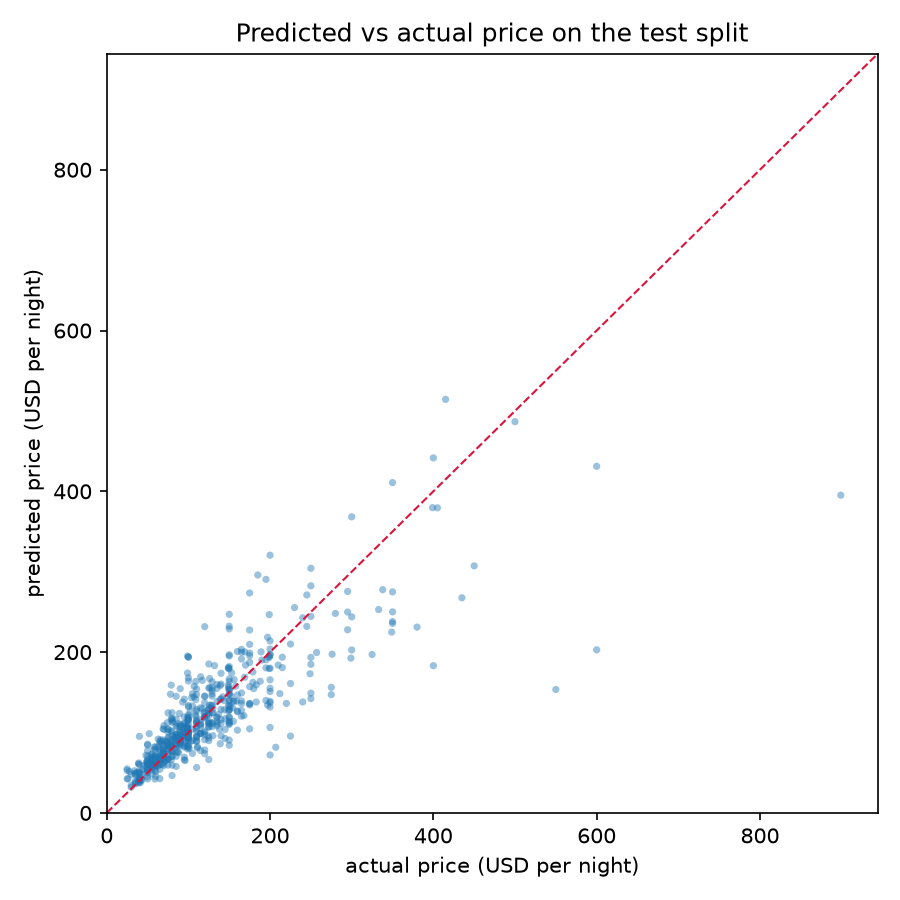
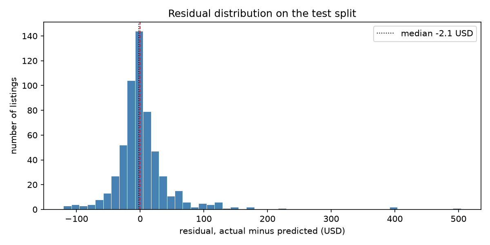

# Seattle Airbnb Price Prediction

AI PI 510 — Module 3, Project 3

- **Prediction form:** https://510-module-3.vercel.app
- **Prediction API:** https://seattle-api-236572670166.us-central1.run.app

The form forwards both requests through the deployed API. The first request
after an idle period takes a few extra seconds while Cloud Run starts an
instance.

## Review the API and form locally

With Docker running and Node.js and npm installed, open two terminals in the
repository root.

**Terminal 1 — start FastAPI**

```bash
docker build -t seattle-airbnb .
docker run --rm -p 127.0.0.1:8000:8000 seattle-airbnb
```

The build trains the model from the included data. Once the server starts,
open the interactive docs to explore the routes and try requests. [FastAPI docs](http://127.0.0.1:8000/docs)

**Terminal 2 — start the form**

```bash
cd interface
npm ci
npm run dev
```

Keep both terminals running and open the form on the same computer. Select
**Estimate nightly price** with the default Capitol Hill listing. The expected
result is **$183.01 USD**. [Prediction form](http://localhost:3000)

## What this is

We predict the nightly price of an Airbnb listing in Seattle.

The prediction API takes room type, Seattle neighbourhood group, guest capacity,
bedrooms and bathrooms. It returns an estimated nightly listing price in US
dollars based on the January 2016 snapshot. Prices and listing patterns may
have changed since the snapshot, and errors may differ by neighbourhood or room type.

The point of the project is not model accuracy. The point is the full path:
cloud data, a reproducible pipeline driven by `config.yaml`, experiment
tracking, a containerised API, and a frontend that calls it.

## Data

Three CSVs from Inside Airbnb, Seattle snapshot of 2016-01-04. Also published
on Kaggle as `airbnb/seattle` under CC0.

| File | Rows | What one row is |
| --- | --- | --- |
| `listings.csv` | 3,818 | One listing: the property, the host, the price |
| `calendar.csv` | 1,393,570 | One listing on one day: bookable or not, and the quoted price |
| `reviews.csv` | 84,849 | One guest review: who, when, what they wrote |

`listings` is the main table. The other two are one-to-many and get aggregated
back into it, so the final dataset stays at 3,818 rows.

## What we have done

### EDA

`notebooks/eda.ipynb`. Findings that changed the plan:

- Price is right-skewed (median $100, max $1,000), so the model trains on `log1p(price)`
- `room_type` is the strongest single feature: median $126 entire home, $69 private room, $40 shared room
- `calendar.price` is only quoted for bookable nights, never impute it for unavailable dates
- `weekly_price` and `monthly_price` are derived from `price` and would leak the target
- `review_scores_rating` is 0-100 while the other six scores are 0-10

### Cleaning

- `$1,200.00` strings parsed to floats, `96%` parsed to 0.96, `t`/`f` parsed to 1/0
- `amenities` is a brace format, not JSON: `{TV,"Cable TV",Internet}` parsed by hand
- `property_type` grouped from 16 values to 7, rare types folded into `Other`
- `minimum_nights` capped at 30 (the raw column reaches 1,000)
- Dropped all-null and zero-variance columns, plus every id, url and free-text column
- Three assertions run on every execution: row count stays at 3,818, listing id stays unique, and calendar-derived availability matches `availability_30`

### Features

107 numeric features, built in `src/preprocess.py`:

- Property: accommodates, bedrooms, bathrooms, beds, cleaning fee, deposit, minimum nights
- Host: response rate, superhost flag, tenure in days, listing count
- Reviews: seven score columns, review count, days since last review, mean comment length
- Calendar aggregates: occupancy over 30 / 90 / 365 days, weekend-to-weekday price ratio
- Location: distance to downtown Seattle, 17 neighbourhood groups
- Amenities: count plus the 20 most common ones as 0/1 columns

### Models

Both are sklearn `Pipeline` objects with the same target, `log1p(price)`.
Metrics are converted back to dollars before scoring.

| Model | Validation MAE | Test MAE | Test R² |
| --- | --- | --- | --- |
| HistGradientBoosting | 26.78 | 27.24 | 0.668 |
| Ridge (imputer + scaler) | 30.00 | 28.75 | 0.633 |

A 24-combination grid search (`script/tune.py`) put every run between 26.5 and
27.6 validation MAE. The best combination on validation scored 27.81 on test,
so the differences are noise. Hyperparameters are not the bottleneck here.

Every run is logged to MLflow, including the grid search.

The API uses a separate gradient-boosting pipeline trained on the five fields
above. It saves the fitted categorical encoders with the model and logs its
validation and test metrics to MLflow. It scored $32.87 validation MAE and
$31.03 test MAE on the same splits as the exploratory models.

Two models, two sets of numbers: the 107-feature model is the research result
reported above, the five-field model is what the live form actually calls. The
second one is weaker because it only sees room type, neighbourhood and capacity.





Both plots are written by `python src/evaluate.py` and logged as MLflow
artifacts on the training run they belong to.

## How to run

```bash
pip install -r requirements.txt

python src/preprocess.py     # raw CSVs -> data/processed splits
python src/train.py          # trains both models, logs to MLflow
python src/evaluate.py       # re-scores the saved model, writes reports/
python script/tune.py        # optional grid search

mlflow ui --backend-store-uri sqlite:///mlflow.db
```

### Train and test the prediction API

From the repository root, use the existing Parquet splits or regenerate them
with `python src/preprocess.py`, then run:

```bash
python -m src.train_serving
python -m uvicorn api.main:app --host 127.0.0.1 --port 8000
```

In a second terminal:

```bash
curl -fsS http://127.0.0.1:8000/health
curl -fsS http://127.0.0.1:8000/metadata
curl -fsS http://127.0.0.1:8000/predict \
  -H 'Content-Type: application/json' \
  -d '{"room_type":"Entire home/apt","neighborhood_group":"Capitol Hill","accommodates":4,"bedrooms":2,"bathrooms":1.5}'
```

`/metadata` lists the room types and neighbourhood groups accepted by the
trained model. The API accepts 1–16 guests, 0–7 bedrooms, and 0–8 bathrooms in
half-bath increments. A successful prediction returns a `nightly_price_usd`
number. FastAPI also exposes interactive documentation at `/docs`.

### Build, train, and serve with Docker

From the repository root:

```bash
docker build -t seattle-airbnb .
docker run --rm -p 127.0.0.1:8000:8000 seattle-airbnb
```

The build trains the model from the committed Parquet splits and packages it
with the API. In a second terminal, run the same `curl` commands above against
port 8000. The container listens on the `PORT` environment variable when set.
The base image is the official Python 3.12 image from Amazon ECR Public. To
pull it from Docker Hub, add `--build-arg PYTHON_IMAGE=python:3.12-slim-bookworm`
to the build command.

To retrain inside the container and serve that run's model, start with an
empty named volume. Stop the first API container before reusing port 8000.

```bash
docker volume create seattle-airbnb-models
docker run --rm -v seattle-airbnb-models:/app/models seattle-airbnb train
docker run --rm -v seattle-airbnb-models:/app/models -p 127.0.0.1:8000:8000 seattle-airbnb serve
```

The volume keeps the trained model between containers. For a retraining run
whose MLflow database and artifacts you want to inspect later, keep its
container by running it with `--name seattle-airbnb-training` in place of
`--rm`. Its tracking data is in `/app/mlflow.db` and the artifact directory
created by MLflow under `/app`.

### Run the prediction form

Start the API on port 8000, then run the Next.js frontend in another terminal:

```bash
cd interface
npm ci
npm run dev
```

Open http://localhost:3000 and select **Estimate nightly price**. The default
Capitol Hill listing returns $183.01 with the bundled model. To use another
API, set `MODEL_API_URL` in `interface/.env.local` before starting Next.js or
building for production. Next.js forwards the metadata and prediction requests.

## Deploy

The API runs on Cloud Run, the form on Vercel. Both sit inside their free tier.

### API

```bash
gcloud auth login
gcloud config set project your-project-id

gcloud run deploy seattle-api \
  --source . \
  --region us-central1 \
  --allow-unauthenticated \
  --port 8000 \
  --memory 1Gi
```

`--source .` uploads the working directory, builds the Dockerfile with Cloud
Build and deploys the last stage, which already has the model baked in. The
`.gcloudignore` file keeps the raw CSVs, the virtualenv and the frontend out of
that upload. `--memory 1Gi` is required: pandas and scikit-learn do not fit in
the default 512 MiB.

On a fresh project the first deploy fails with `PERMISSION_DENIED` until the
build service accounts receive `roles/serviceusage.serviceUsageConsumer`,
`roles/cloudbuild.builds.builder` and `roles/storage.objectAdmin`. The grant
needs a few minutes to propagate before the retry succeeds.

### Form

Import the repository into Vercel, set **Root Directory** to `interface`, and
add `MODEL_API_URL` with the Cloud Run URL. `interface/next.config.ts` rewrites
`/api/metadata` and `/api/predict` to that address, so the browser only talks to
the Vercel origin and there is no CORS setup to maintain.

## Repo layout

```
config.yaml          every path and parameter the pipeline uses
src/preprocess.py    read, clean, merge, engineer features, split
src/train.py         train, score, log to MLflow, save the model
src/train_serving.py train and log the five-input model used for predictions
src/evaluate.py      reload the model, rebuild the metrics and plots
script/tune.py       grid search over the boosting parameters
notebooks/eda.ipynb  the exploration behind every decision above
data/                raw data, interim export and processed training splits
models/              local model artifacts and the research model card
reports/             the two evaluation plots referenced above
interface/           Next.js frontend
api/                 FastAPI prediction service
Dockerfile           container build for training and serving
.gcloudignore        keeps data and the frontend out of the Cloud Build upload
```

## Limitations

- The snapshot is from January 2016. Seattle prices and the short-term rental
  market have moved a lot since, so the numbers are not a current estimate.
- `listings.price` is the advertised nightly rate, not what guests actually
  paid. Discounts and fees are not in the data.
- The five-field serving model cannot see amenities, host history, seasonality
  or review scores, so it is weaker than the research model by about $4 MAE.
- Average error is roughly 30% of the median nightly price. A prediction is a
  reference point, not a pricing decision.
- Neighbourhood is a strong input, so the model inherits whatever pricing
  patterns existed in 2016, including any disparities between areas.
- Not usable for real pricing, lending or regulatory decisions.

## Status

Done: data download, EDA, cleaning, feature engineering, training,
evaluation, MLflow tracking, `config.yaml`, the FastAPI service, Docker
packaging for training and serving, deployment to Cloud Run, and the Next.js
form on Vercel.

Not done yet:

- Hosting the data in cloud storage and reading it from S3 inside the pipeline

## Next

1. Move the raw CSVs to cloud storage and add a `source` switch to `read_files`
2. Drop `data/raw` and `data/interim` from git once the pipeline can fetch them
3. Trim MLflow out of the runtime image and into a build-only dependency
3. Host the cleaned dataset in cloud storage and have the pipeline pull from there
